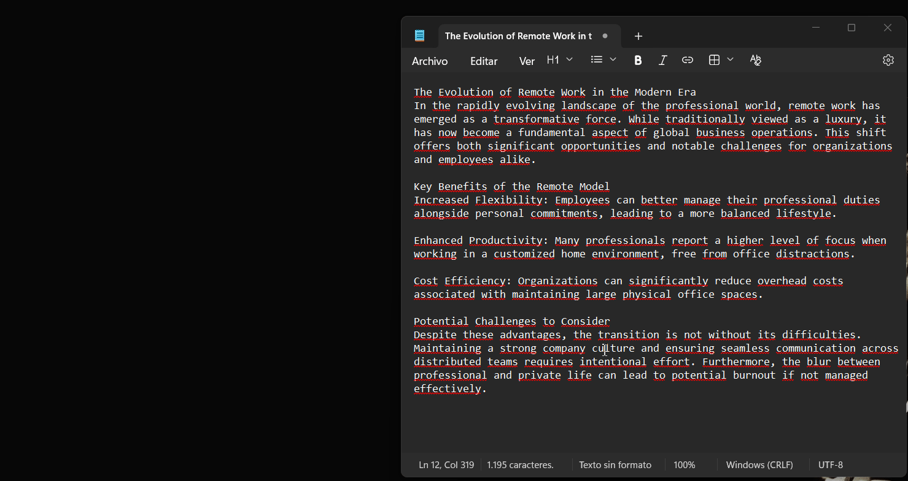
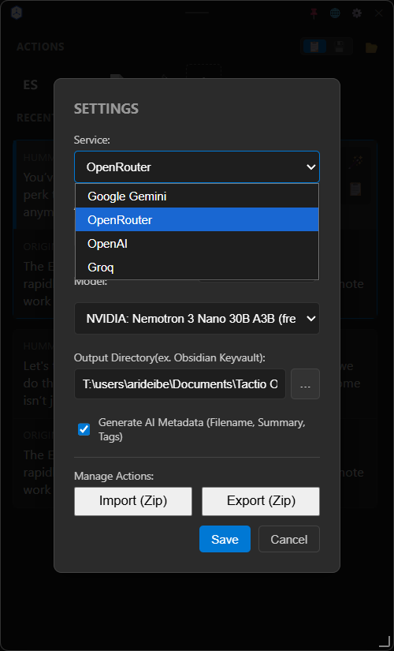
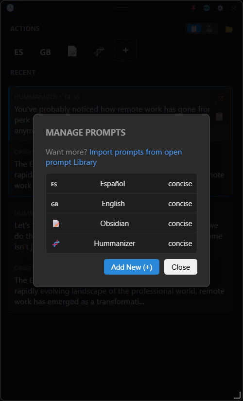
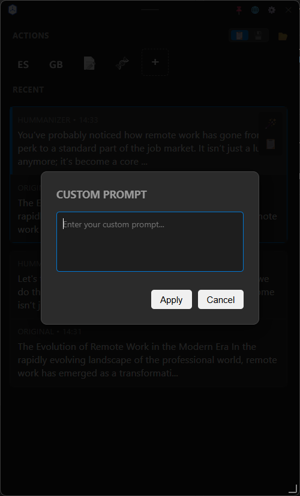
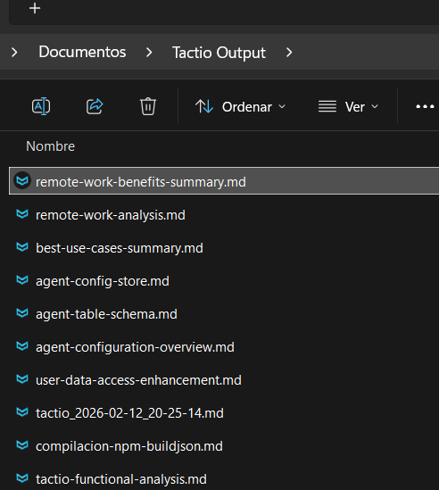
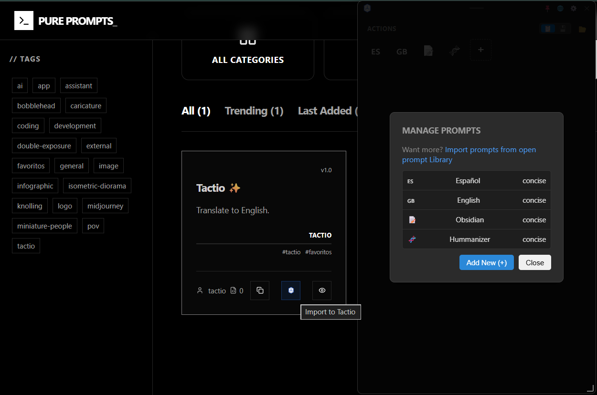

<div align="center">


# Tactio

**Copy. Transform. Paste. 🚀**
<br>
*Your AI-driven, invisible productivity companion.*

[](https://opensource.org/licenses/MIT)
[](https://nodejs.org/)
[](https://www.electronjs.org/)

</div>

---

## 🎯 The Mission: Universal AI Utility, Native & Immediate

**Tactio** is a powerful productivity utility designed to bring multiple LLMs directly into your workflow. While it excels at leveraging **Free Tiers** (Google Gemini, Groq, OpenRouter) to provide high-end AI capabilities at zero cost, its true power lies in its **context-free interaction**. 

Forget about switching tabs or copy-pasting into chat interfaces. With a single keystroke, you can apply complex transformations to any text on your screen and get the result injected back instantly.

<div align="center">
  
  <br>
  <i>See Tactio in action: Copy text, trigger with Ctrl+Shift+G, select an AI action, and watch it paste!</i>
</div>

---

## 📸 Visual Walkthrough

### 🚀 Powerful & Flexible UI
Our sleek, dark-themed interface is designed for speed and clarity.

| Core Features | Customization |
| :--- | :--- |
|  <br> **Smart Settings**: Choose your favorite LLM (Gemini, OpenRouter, Groq, OpenAI), manage your API keys securely, and set up your preferred output directories. |  <br> **Action Catalog**: Browse and manage your library of AI transformations. Add new ones or refine existing prompts to fit your workflow. |
|  <br> **On-the-fly Magic**: Need a quick, one-off transformation? Use the Custom Prompt tool to talk to the AI without creating a permanent action. |  <br> **Knowledge Base Ready**: Automatically save your AI results as clean, formatted Markdown files—perfect for Obsidian, Notion, or your project docs. |

### 🌐 ecosystem Integration
Tactio doesn't just live in your tray; it connects to the wider prompt ecosystem.

<div align="center">
  
  <br>
  <b>One-Click Install from Pure Prompts</b>: Browse high-quality, community-tested prompts on <a href="https://pureprompts.vercel.app/">purePrompts</a> and install them directly into Tactio with a single click.
</div>

---

## 🔗 Seamless purePrompts Integration

Tactio integrates natively with [purePrompts.vercel.app](https://pureprompts.vercel.app/). Browse our curated catalog of high-quality, community-tested prompts and **install them directly into your Tactio app with a single click**. No manual copying across apps—your new superpower is immediately available from the hotkey menu!

---

## 🔥 Best Use Cases

Unlock your full potential with these powerful built-in transformations:

### 💻 For Developers (Code)

* **🐛 Bug Detection**: Instantly review code snippets for logical errors, edge cases, and performance bottlenecks.
* **♻️ Safe Refactoring**: Rewrite code to improve readability and structure while maintaining the exact same functionality.
* **📖 Step-by-Step Explanation**: Demystify complex code blocks line-by-line using accessible language.
* **⚡ Performance Optimization**: Identify bottlenecks (time/memory complexity) and get a highly optimized version.

### 📝 For Writers & Content (Text)

* **✂️ Professional Rewrite**: Transform raw thoughts into clear, direct, and professional text, eliminating jargon and errors.
* **🌍 Contextual Translation**: Translate text accurately while preserving technical terms and tone.
* **📌 Ultra-short TL;DR**: Generate a 2-sentence summary that captures the absolute core idea of a long text.
* **📋 Text to Checklist**: Turn unstructured emails or meeting notes into actionable checklist items.

### ✉️ For Communication (Emails & Messages)

* **🚀 Fast Replies**: Generate brief, professional email responses including next steps and clear answers.
* **🕊️ Tone Softener**: Make collaborative feedback sound constructive rather than aggressive.
* **🧵 Thread Summarization**: Condense long conversation threads into a 10-line summary of "who said what" and "what's pending".

### 📚 For Documentation & Architecture

* **📄 Generate Tech Docs**: Turn logic/code into Markdown docs with params, outputs, and examples.
* **🎯 Decisions & Risks Extractor**: Pull out key decisions, identified risks, and open questions from meeting notes.
* **⚙️ Snippet Creator**: Convert raw text into a reusable template with `[PLACEHOLDERS]`.

---

## 🚀 Key Features

* **⌨️ Global Hotkey**: Trigger the app instantly from anywhere (`Ctrl+Shift+G` / `Cmd+Shift+G`).
* **🧠 Context-Aware**: Reads your current clipboard content automatically.
* **🖱️ Floating UI**: Appears right next to your mouse cursor for zero context switching.
* **🌐 Multi-Provider Support**: Choose between Google Gemini, OpenRouter, OpenAI, and Groq.
* **⏳ History & Eras**: Track transformations and create versions (eras) of an item by chaining prompts.
* **One-Click Apply**: Automatically injects the transformed text back into your active application!
* **No Context Switching**: Trigger, select, and receive—all without leaving your current app.

---

## 🧠 Technical Architecture & LLM Integration

Tactio is built with security and performance in mind:

*   **Provider Agnostic**: Integrates natively with the **Google Generative AI SDK** for Gemini and uses optimized API calls for **OpenRouter**, **Groq**, and **OpenAI**.
*   **Secure Key Management**: API keys are stored locally and encrypted using Electron's `safeStorage` API. They are never sent to third-party servers (other than the LLM provider itself).
*   **IPC Communication**: Uses an asynchronous Inter-Process Communication (IPC) bridge between the Node.js backend (Main) and the UI (Renderer) for a lag-free experience.
*   **Native Control**: Leverages `robotjs` for low-level keyboard simulation, enabling the "Copy-Transform-Paste" loop across any application.

---

## 📦 Download & Install

### Windows (Recommended)

The easiest way to get started is to download the latest version from our **[Releases page](https://github.com/aralde/tactio/releases)**.

*   **[Tactio-Setup.exe](https://github.com/aralde/tactio/releases)**: The standard installer (NSIS). Recommended for most users.
*   **[Tactio-Portable.exe](https://github.com/aralde/tactio/releases)**: No installation required. Just download and run! 🚀

---

## 🛠️ Installation & Setup (For Developers)

### Prerequisites

* **Node.js**: v18 or higher.
* **API Keys**: Get one from [Google Gemini](https://aistudio.google.com/app/apikey), [OpenRouter](https://openrouter.ai/keys), [Groq](https://console.groq.com/keys), or [OpenAI](https://platform.openai.com/api-keys).

### Quick Start

1. **Clone & Install**:

   ```bash
   git clone https://github.com/aralde/tactio.git
   cd tactio
   npm install
   ```

2. **Rebuild Native Modules** (Crucial for `robotjs`):

   ```bash
   npm run rebuild
   ```

3. **Launch Tactio**:

   ```bash
   npm start
   ```

---

## ⚙️ Configuration

Tactio features a sleek built-in **Settings UI**. No `.env` files required!

1. Click the **Gear Icon** in the header.
2. Select your **LLM Provider** and enter your **API Key** (stored securely via Electron's `safeStorage` in `%APPDATA%/tactio/.tactiorc`).
3. Choose your preferred **Model** and manage your **Custom Actions**.

## 📄 License

Released under the **MIT License**.

<div align="center">
  <i>Built with ❤️ by <a href="http://github.com/aralde/">aralde</a> to turbocharge your productivity.</i>
</div>
